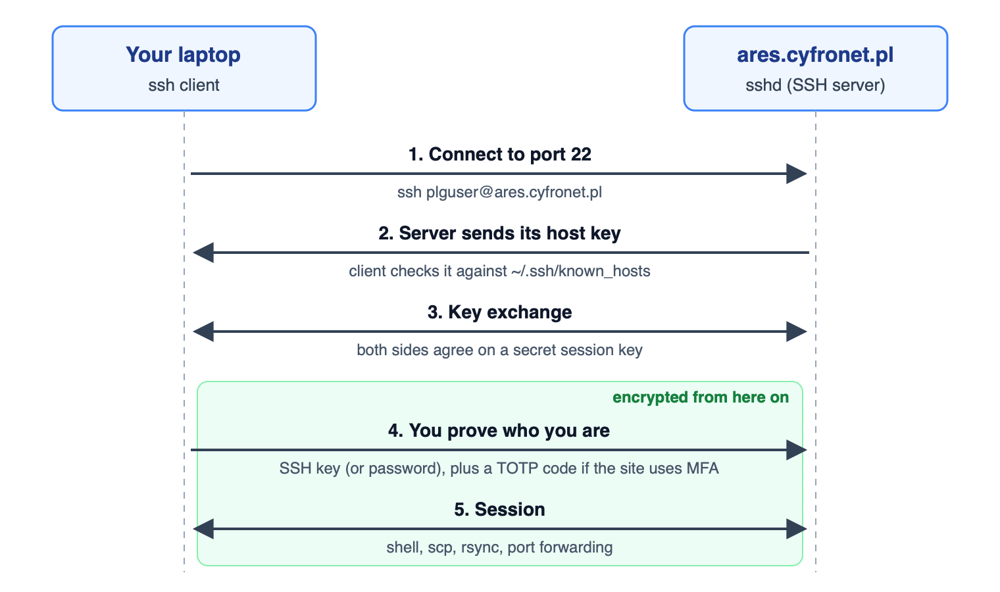

# 01 First login and the `known_hosts` file

[Agenda](README.md) | Next: [02 Generate keys](02-generate-keys.md)

**Time:** 0:00-0:04

## How SSH works



1. Your SSH client connects to the server on port 22.
2. The server proves its identity with its **host key**. Your client checks it against `~/.ssh/known_hosts` (this file is the topic of this step).
3. Both sides agree on a secret session key, so everything after this point is encrypted.
4. You prove who you are: with an SSH key (next steps) or a password, plus a one-time code on sites that use MFA.
5. You get a shell, or transfer files with `scp` and `rsync`.

## What happens on the first connection

```
ssh plguser@ares.cyfronet.pl
```

SSH has never seen this server, so it shows a prompt like:

```
The authenticity of host 'ares.cyfronet.pl (...)' can't be established.
ED25519 key fingerprint is SHA256:L29mPfAuIBwM6H73lCEi4TUmXE9tFRLWbXRW0QtRKA8.
Are you sure you want to continue connecting (yes/no/[fingerprint])?
```

- The server proves its identity with a **host key**. The fingerprint is a short hash of it.
- Compare the fingerprint with the [table below](#host-key-fingerprints-of-cyfronet-clusters) before typing `yes`. Otherwise you could be talking to an impostor (man-in-the-middle). You can also paste the expected fingerprint at the prompt instead of `yes`, and SSH checks it for you.
- After `yes`, the host and its key are stored in `~/.ssh/known_hosts` (Windows: `C:\Users\<name>\.ssh\known_hosts`).
- On every later login SSH compares the server's key with the stored one and connects silently if they match.

Then SSH asks for authentication. Without a registered key this is typically a password or other method that your site allows; later we switch to keys.

## Host key fingerprints of Cyfronet clusters

Login nodes are taken from the [Cyfronet supercomputer documentation](https://docs.hpc.cyfronet.pl/supercomputers/). Your client usually shows the ED25519 fingerprint; the others appear only if your client prefers another key type.

| Computer | Login node | Key type | Fingerprint |
|---|---|---|---|
| **Ares** | `ares.cyfronet.pl` | ED25519 | `SHA256:L29mPfAuIBwM6H73lCEi4TUmXE9tFRLWbXRW0QtRKA8` |
| | | ECDSA | `SHA256:W0Oc1aPpn592vJJektyKq+PaMNF8rn56tJ+TfVhl1DE` |
| | | RSA | `SHA256:s25sWiMsP8biNTFRq4WvdfSj4vZGb7Lke9n9QQlUJxE` |
| **Athena** | `athena.cyfronet.pl` | ED25519 | `SHA256:4XJ7YOvwU/HeGk7sPsr3BoRIJkPzALTj0jHb3sqEm+Q` |
| | | ECDSA | `SHA256:j59Kgh38DeK0ctQvzekvzjPVnNpKAHewJ1FcdLcmmUk` |
| | | RSA | `SHA256:QcXTKo9cW+oLUdEGu7r4WMqduolpeM0YPbzzI3rJfkc` |
| **Helios** | `helios.cyfronet.pl` | ED25519 | `SHA256:YX2hlk2eYYYfYrakjzdk7syklFfXZWAwAX63l2+hArE` |
| | | ECDSA | `SHA256:IVtGssOg+U2r39B6noMwU6uxyfPXfMUU35hELVV5dFM` |
| | | RSA | `SHA256:RNDNbKY4mKNDIi6w2iaz1Sqwctlb4OBfqjnjnYHG0oI` |


## Look at the file

```
cat ~/.ssh/known_hosts
ssh-keygen -F ares.cyfronet.pl      # find the entry for a host
```

Entries may be hashed (`|1|...`), which hides host names but works the same way.

## Warning: host identification has changed

```
@@@@@@@@@@@@@@@@@@@@@@@@@@@@@@@@@@@@@@@@@@@@@@@@@@@@@@@@@@@
@    WARNING: REMOTE HOST IDENTIFICATION HAS CHANGED!     @
@@@@@@@@@@@@@@@@@@@@@@@@@@@@@@@@@@@@@@@@@@@@@@@@@@@@@@@@@@@
```

Possible causes: the server was reinstalled or its keys rotated (common and harmless), or someone is intercepting the connection (rare, serious).

What to do:

1. **Do not** just delete the whole file or ignore the warning.
2. Check with the support team or the official documentation whether the host key changed.
3. Only if confirmed, remove the old entry: `ssh-keygen -R ares.cyfronet.pl`
4. Connect again and verify the new fingerprint.

## Exercise

1. Connect to `ares.cyfronet.pl` and read the fingerprint prompt.
2. Answer `yes` only after comparing the fingerprint with the documentation.
3. Find the new entry with `ssh-keygen -F ares.cyfronet.pl`.

---
[Agenda](README.md) | Next: [02 Generate keys](02-generate-keys.md)
